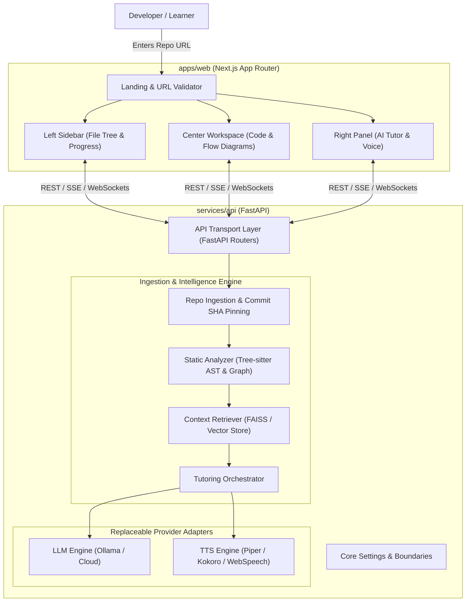

# RepoMentor AI — System Architecture

## 1. High-Level Overview

**RepoMentor AI** is a technical mentoring platform designed to help developers deeply comprehend unfamiliar software codebases. Rather than acting as a surface-level README summarizer or generic chatbot, RepoMentor AI pairs deterministic static code analysis with grounded retrieval-augmented intelligence and interactive visualization.

## 2. Core Architectural Principles

1. **Separation of Concerns**: Presentation (Next.js), API transport (FastAPI), ingestion, AST parsing, retrieval, and LLM inference reside in decoupled modules behind clean interfaces.
2. **Deterministic Grounding Over Hallucination**:
   - Facts extracted directly via AST (functions, classes, dependencies, imports) are ground truth.
   - LLM explanations cite exact file paths and line ranges (`file.py#L42-L68`).
3. **Immutable Commit Pinning**: Every analysis run resolves the current default branch HEAD to an immutable Git commit SHA. Caching and index storage keys are keyed by `(repo_url, commit_sha)`.
4. **Untrusted Input Boundary**: External repositories are strictly treated as untrusted data. Ingestion never executes repository code (`eval`, `exec`, arbitrary test runners, or unvetted scripts).
5. **Replaceable Model & TTS Providers**: LLMs (Ollama local, OpenAI, Anthropic) and voice engines (Piper, Kokoro, WebSpeech) implement unified abstract interfaces to prevent vendor lock-in.
6. **Graceful Degradation**: Core code navigation and AST parsing function completely offline without requiring an active LLM or vector model.

## 3. System Components

### Frontend (`apps/web`)
- **Framework**: Next.js 14+ (App Router), React 18/19, TypeScript (strict mode).
- **Styling**: Tailwind CSS with a clean, low-fatigue dark workspace theme.
- **Code Viewer**: Syntax highlighting, gutter line numbering, and interactive token links to AST definitions.
- **Architecture Graph**: Interactive node-edge dependency visualization (React Flow).
- **Tutor Panel**: Conversational tutor interface, voice synthesis playback controls (play, pause, mute, interrupt), and progressive learning milestones.

### Backend (`services/api`)
- **Framework**: FastAPI (Python 3.11+), Pydantic v2 schemas for all inputs/outputs.
- **Asynchronous Execution**: Long-running ingestion and graph construction jobs run asynchronously with observable status.
- **Health & Diagnostics**: `/api/v1/health` providing service status, version, and dependency readiness.

### Shared Types (`packages/shared-types`)
- Shared TypeScript and JSON schema definitions ensuring type synchronization across API and web boundaries.

## 4. Ingestion & Security Guardrails
- **Host Restriction**: Only authorized hosts (`github.com`) are permitted.
- **SSRF Protection**: Private IP ranges (RFC 1918), loopback (`127.0.0.1`), link-local (`169.254.0.0/16`), and AWS/GCP metadata services (`169.254.169.254`) are strictly blocked.
- **Size & Rate Limits**: Configurable repository file count and byte limits protect against denial-of-service and memory exhaustion.
